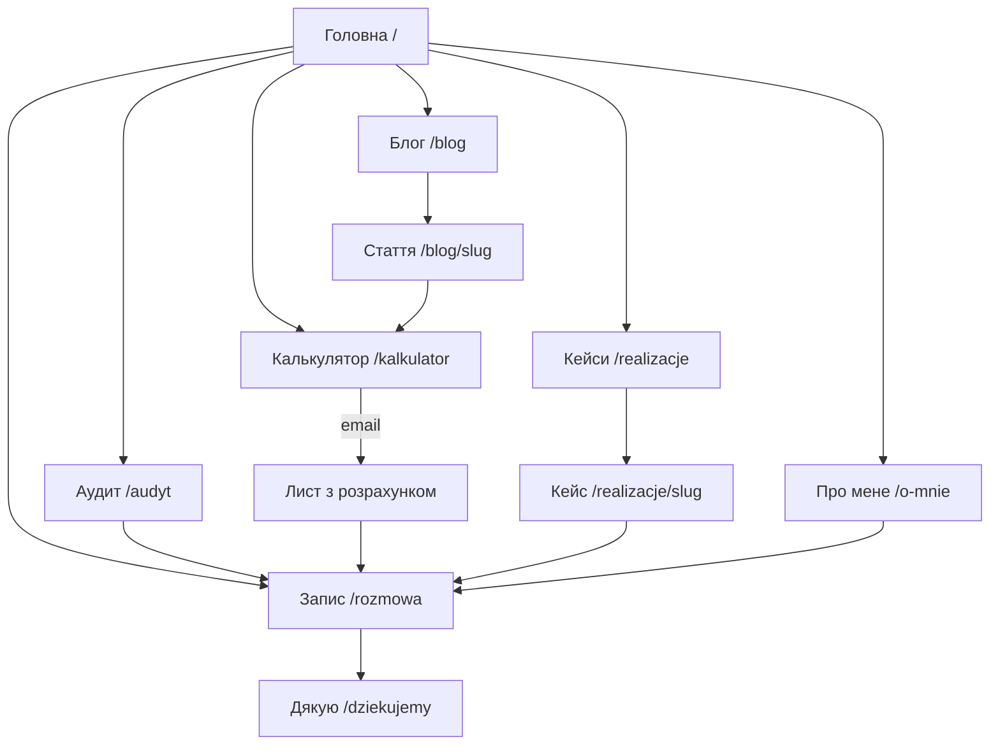

# Архітектура сайту: посил для відвідувача і продажі

Версія 1 · 23.10.2026. Робочий документ. Замінює три версії з `site-versions-brand.md`: тут одна обрана лінія.
Notion (курс «Побудова особистого бренду», домашки) використано як базу знань.

---

## 0. Зафіксовані рішення

| Що | Рішення |
|---|---|
| Для кого | Компанії від 5 до 200 людей, Польща та ЄС, потім США. Рішення ухвалює власник, директор або COO. |
| Що продаємо | Аудит процесів → AI-автоматизації та інтеграції (n8n, Make, AI-агенти, RAG, документи, розсилки) → навчання команди → супровід |
| Головна ідея | **Рутину — агентам, рішення — людям** |
| Переконання | В еру AI люди стають важливішими, ніж до цього |
| Тон | Прямо про інструменти, дбайливо з людьми |
| Червона лінія | Не беру проєкти, де мета — звільнення людей |
| Hero H1 | «Ваша команда тоне в ручній роботі. Я передаю її AI-агентам.» (погоджено) |
| ROI-калькулятор | Залишаємо |
| «Про мене» | Затверджений текст: `docs/content/about-me.md` |
| Ємність | ~10 год/тиждень, тому сайт має відсіювати, а не лише збирати ліди |
| Мови | PL (основна), EN, UA |

---

## 1. Ідея сайту

Відвідувач — власник або директор компанії на 5–200 людей. Його команда тоне в Excel, пошті й ручних кроках. До AI він ставиться з підозрою: або це хайп, або зміни, які налаштують людей проти нього.

Сайт проводить його через чотири стани:
1. «Це про нас».
2. «Ось скільки це нам коштує».
3. «Ось людина, яка вже робила це в компаніях, і люди потім цим користувалися».
4. «Почати можна з 30-хвилинної розмови».

**Чим відрізняємось від агенцій на n8n і Make.** Вони продають флоу, а ти — автоматизації, якими люди справді користуються. Рішення про гроші й людей при цьому лишаються за людьми.

---

## 2. Message house

**Парасолька:** Рутину — агентам, рішення — людям.

| Опора | Обіцянка | Докази | Де на сайті |
|---|---|---|---|
| **Час** | Повертаю команді години рутини | Калькулятор; звіт для правління з 4–5 год до 5–10 хв; 30 stories з одного брифу | Калькулятор, кейси, «Понеділок після» |
| **Люди** | Автоматизації, якими люди користуються; рішення за людьми | 90% працівників користуються ERP після впровадження; після переходу в CRM жоден відділ не повернувся до Excel; Human Gate у кожному флоу | Позиція, метод, FAQ |
| **Досвід** | 5+ років CRM, ERP і AI, сам будую | Jira-агент: −87% витрат на AI, 0% галюцинацій на операціях запису, 10–15 людей у пілоті; 600–800 тис. рядків без критичних втрат; 2-ге місце серед 70+ команд на AI-хакатоні; власний SaaS | Історія, кейси, «Про мене» |

**Що важливо різним людям:**
- **Власник, директор:** скільки злотих втрачається, ризик, ріст без найму нових людей.
- **COO, менеджер:** менше рутини в команді, вчасні KPI, ніхто не боїться втратити роботу.

**Словник:**
- **Пишемо:** повернені години, рутина, людина ухвалює рішення, пілот, карта процесів.
- **Не пишемо:** скоротити штат, FTE/штатні ставки, гарантую, революція, «70% не вміють», цифри без джерела.

---

## 3. Сюжет

Схема StoryBrand: клієнт — герой, ти — провідник.

| Елемент | На сайті |
|---|---|
| Герой | Власник компанії на 5–200 людей |
| Зовнішня проблема | Рутина, Excel, загублені заявки, ручні звіти |
| Внутрішня проблема | «Я гашу пожежі замість того, щоб розвивати бізнес» |
| Філософська проблема | AI мав би допомагати людям, а його продають як заміну людей |
| Провідник | Михайло: емпатія (бачив цей хаос зсередини) + авторитет (кейси з цифрами) |
| План | 4 кроки методу |
| Заклик | Розмова 30 хв (прямий), калькулятор з листом (перехідний) |
| Ставки (що буде, якщо нічого не робити) | Калькулятор: «ручна робота коштує вам N zł на рік» |
| Успіх | «Понеділок після»: той самий понеділок, 9:14, але спокійний |

**Рамка історії:** hero відкривається понеділком о 9:14 у хаосі, передфінальна секція закривається тим самим понеділком після впровадження.

---

## 4. Карта сайту

| Сторінка | URL (PL / UA / EN) | Навіщо | Головний CTA | Етап |
|---|---|---|---|---|
| Головна | `/` · `/ua/` · `/en/` | Уся історія і продаж | Розмова 30 хв | MVP |
| Аудит процесів | `/audyt` · `/ua/audyt` · `/en/audit` | Перший платний продукт | Замовити аудит | MVP |
| Калькулятор | `/kalkulator` · `/ua/kalkulyator` · `/en/calculator` | Лід-магніт, SEO, «переслати директору» | Отримати розрахунок на пошту | MVP |
| Кейси | `/realizacje` + 4 сторінки | Докази в деталях | Обговорити схожий процес | MVP |
| Про мене | `/o-mnie` · `/ua/pro-mene` · `/en/about` | Довіра до людини | Розмова 30 хв | MVP |
| Блог | `/blog` + 3 статті на старті | SEO, постійність, довіра | Калькулятор / розмова | MVP (PL) |
| Запис | `/rozmowa` · `/ua/rozmova` · `/en/call` | 2 питання + календар | Забронювати | MVP |
| Дякую | `/dziekujemy` | Підтвердження й підрахунок конверсій | Що підготувати до дзвінка | MVP |
| Політики | `/polityka-prywatnosci`, `/cookies` | GDPR | — | MVP |
| Галузеві лендінги | `/e-commerce`, `/agencje-rekrutacyjne`, `/firmy-uslugowe` | SEO й реклама під галузь | Розмова 30 хв | Етап 2 |
| Рентген процесу | `/rentgen` | Окремий AI-інструмент | Надіслати схему / розмова | Етап 2 |

**Меню:** Що автоматизую · Кейси · Аудит · Про мене · Блог · [Записатися].
**На мобільному:** липка кнопка «Записатися» після першого екрана.

---

## 5. Головна сторінка секція за секцією

| # | Секція | Що має подумати відвідувач | Текст (чернетка) | Інтерактив (з каталогу) | CTA |
|---|---|---|---|---|---|
| 1 | **Hero** | «Це про мою проблему, і за цим стоїть жива людина» | Eyebrow: «AI-автоматизації та інтеграції для компаній від 5 до 200 людей». H1: «Ваша команда тоне в ручній роботі. Я передаю її AI-агентам.» Sub: «Знаходжу, де команда втрачає години, і автоматизую рутину на n8n, Make та AI-агентах. Рутину — агентам, рішення — людям.» Фото + 3 цифри. | Hero A «Стос сповіщень» | Розмова 30 хв · Порахувати втрати |
| 2 | **Що я автоматизую** | «Він розуміє мій бізнес і знає, що саме робити» | «Схоже на вашу компанію?» Перемикач: E-commerce / HR і рекрутинг / Сервісні та IT-компанії / Будь-яка команда. По 4 «було → стало». | Галузі C «Клікніть ручні кроки» або A (перемикач) | — |
| 3 | **Ціна хаосу** | «Це коштує нам N zł на рік. Треба щось робити» | «Скільки коштує ручна робота у вашій компанії». Метрики: години на людину, zł на рік, що команда робитиме замість рутини. Без FTE. | ROI A (повзунки + графік) | Надіслати розрахунок на пошту |
| 4 | **Позиція** | «Цей не продає AI-хайп і не налаштує людей проти мене» | «Чому я роблю це інакше». 3 принципи: рутину — агентам, рішення — людям; спершу слухаю команду; міряю в повернених годинах. + «Не беру проєкти, де мета — звільнення людей». | Текст, що проявляється (Успіх B) | — |
| 5 | **Історія** | «Він пройшов цей шлях і має результати» | Затверджений текст «Про мене» (скорочений до 3 абзаців) + фото. | Історія A (липкий рік) або C (еволюція компанії) | Читати повністю → /o-mnie |
| 6 | **Кейси** | «Це працює в реальних компаніях» | Jira-агент (−87%, 0% галюцинацій на записі, 10–15 людей у пілоті), ERP (600–800 тис. рядків, 90% користуються), CRM (без повернення в Excel), контент-фабрика (30 stories). + 2–3 відгуки. | Кейси A (великі цифри) | Обговорити схожий процес |
| 7 | **Як я працюю** | «Зрозуміло, що буде, і ризик малий» | 4 кроки методу, без дедлайнів: Слухаю → Автоматизую → Навчаю → Міряю. Human Gate у кожному флоу. | Процес C (ноди флоу) | — |
| 8 | **Рентген процесу** | «Для мого процесу це реально» | «Опишіть рутину, і агент покаже схему автоматизації». | Рентген C (3 питання) | Обговорити цю схему на дзвінку |
| 9 | **Пропозиція й ціни** | «Почати можна з малого» | Розмова 0 zł → Аудит від 2 499 zł netto (зараховується у впровадження) → Впровадження за кошторисом етапу → Супровід від … zł/міс. | Ціни B (сходинки) | Замовити аудит |
| 10 | **Понеділок після** | «Хочу, щоб у нас було так» | «Ваш ранок починається з одного повідомлення». Агент о 8:00 надсилає підсумок, людина натискає «Схвалити». | Успіх C (Telegram) | — |
| 11 | **FAQ** | «Мої страхи зняті» | AI замінить людей? Дані й GDPR? Що, як зламається? Потрібен свій розробник? Скільки триває? Чому без погодинної ставки? Чи має сенс для 5 людей? | FAQ A (акордеон) | — |
| 12 | **Запис** | «Легкий наступний крок» | «Почнімо з вашого понеділка». Що буде на розмові (4 пункти) → 2 питання → календар. | Запис C (кваліфікація) | Забронювати |

**Проміжні CTA:**
- після калькулятора — email;
- після кейсів і рентгену — запис;
- на телефоні — липка кнопка.

**Фон:** один активний фон тільки в hero («Хаос → порядок» або «Аврора»), решта сторінки статична.

---

## 6. Інші сторінки

**Аудит процесів (`/audyt`)** — головна платна точка входу:
1. Для кого (5–200 людей, рутина, Excel, загублені заявки).
2. Що ви отримуєте:
   - карта процесів;
   - години по кожному процесу;
   - 3–5 пріоритетів за ROI;
   - план і кошторис впровадження.
3. Як проходить: інтерв'ю з командою → аналіз систем і даних → презентація результатів.
4. Ціна: від 2 499 zł netto, зараховується у впровадження.
5. Приклад сторінки карти процесів (розмитий).
6. FAQ.
7. Запис.

**Кейс (`/realizacje/[slug]`), шаблон:**
1. Контекст.
2. Проблема в цифрах.
3. Що зробили (схема флоу).
4. Де Human Gate.
5. Результат у цифрах.
6. Що сказала команда.
7. Стек.
8. CTA.

**Про мене (`/o-mnie`):**
- повний затверджений текст;
- 3 принципи;
- «чого я не роблю» (червона лінія);
- досвід, сертифікати, хакатони;
- фото;
- CTA.

**Калькулятор (`/kalkulator`):**
- інструмент;
- як рахуємо (прозора формула);
- email з розрахунком і 3 процесами, з яких варто почати.

**Блог (`/blog`):**
- рубрики:
  - кейси й розбори — 40%;
  - «як автоматизувати X» — 40%;
  - думки «AI і люди» — 20%;
- три статті на старті (PL):
  1. «Ile kosztuje ręczna praca w firmie» — веде на калькулятор;
  2. «Automatyzacja zamówień i faktur: od Excela do n8n»;
  3. «Dlaczego wdrożenia AI się nie przyjmują — i jak to zmienić».

**Запис (`/rozmowa`):**
- 2 питання: розмір компанії, що болить;
- для 1–4 людей замість календаря — чекліст на пошту;
- для 5+ — Cal.com;
- блок «що буде на розмові».

---

## 7. Як сайт продає: воронка

| Етап | Де | Посил | Що приходить тобі в Telegram | Що міряємо |
|---|---|---|---|---|
| Трафік | LinkedIn, Google, рекомендації, блог | Ваша проблема має рішення | — | Відвідування за джерелами |
| Залучення | Hero, калькулятор, рентген | Подивіться на свої цифри | — | % тих, хто запустив калькулятор чи рентген |
| Лід | Email з калькулятора, бронювання, рентген | Розрахунок / схема / розмова | Email, розмір компанії, біль, цифри з калькулятора, відповіді рентгену, джерело | Лідів на тиждень, % кваліфікованих |
| Розмова 30 хв | Cal.com, Google Meet | Чесна оцінка, чи окупиться | Нагадування за годину | % розмов, що закінчились пропозицією аудиту |
| Аудит | Пропозиція + передоплата | Карта процесів і план | — | % розмов → аудит |
| Впровадження | Кошторис етапу, передоплата | Пілот на одному процесі | — | % аудитів → впровадження |
| Супровід | Підписка | Флоу не ламаються, нові сценарії | — | Утримання, години на місяць |
| Кейс і рекомендація | Після пілоту | Кейс на сайт + відгук за шаблоном | — | Кейсів на квартал |

**Листи після калькулятора (4 штуки, інтервал 2–3 дні):**
1. Ваш розрахунок і 3 процеси, з яких я б почав.
2. Історія ERP: чому людям прижилося.
3. Чому автоматизації не приживаються і що з цим робити.
4. Запрошення на розмову 30 хв.

**Що буде на 30-хвилинній розмові** (показуємо на сайті, щоб людям було легше записатися):
1. Ваш процес.
2. Де губляться години.
3. Чи окупиться автоматизація.
4. Наступний крок: аудит або «поки не варто».

**Правила рішень (переглядаємо раз на місяць):**
- Калькулятор запускає мало відвідувачів → піднімаємо його вище або міняємо тизер у hero.
- Багато лідів від компаній на 1–4 людей → посилюємо фільтр і текст «для кого».
- Розмови не переходять в аудит → переписуємо сторінку `/audyt` і скрипт розмови, а не трафік.

**Аналітика:**
- Umami або Plausible (без cookies);
- Google Search Console;
- Clarity — лише за згодою;
- події:
  - `cta_hero`, `calc_used`, `calc_email`, `xray_done`;
  - `booking_started`, `booking_confirmed`;
  - `lead_qualified` / `lead_small`.

---

## 8. Назва методу

Lohaza Loop відкинуто (небажана асоціація для російськомовних читачів). Іменні назви з прізвищем далі не розглядаємо.

| Варіант | Як звучить | Чому |
|---|---|---|
| **Human Gate** (рекомендація) | «Метод Human Gate: у кожному флоу є точка, де рішення ухвалює людина» | Назва несе головну відмінність, це твоя реальна практика, звучить однаково в PL, EN, UA |
| Hybrid Team | «Гібридна команда: агенти беруть рутину, люди — рішення» | Зрозуміло, але загальніше |
| Time Back | «Повертаю час команді» | Найпростіша вигода, але найменш своя |

**4 кроки (без дедлайнів):**
1. **Слухаю.** Інтерв'ю з командою, карта рутини.
2. **Автоматизую.** n8n, Make, AI-агенти, інтеграції; у кожному флоу є Human Gate.
3. **Навчаю.** Команда вміє користуватися і не боїться.
4. **Міряю.** Повернені години й частка людей, які реально користуються, потім наступний процес.

Перед публікацією перевірити, що назва не зайнята як торгова марка.

---

## 9. Що потрібно від Михайла

1. Назва методу (рекомендація Human Gate).
2. 2–3 відгуки колег або клієнтів для кейсів (шаблон: проєкт, результат, цифра, риса).
3. Домен.
4. Ціни супроводу (зараз лише аудит від 2 499 zł netto).
5. Перевірити договір з роботодавцем щодо сторонньої діяльності перед публічним запуском.
