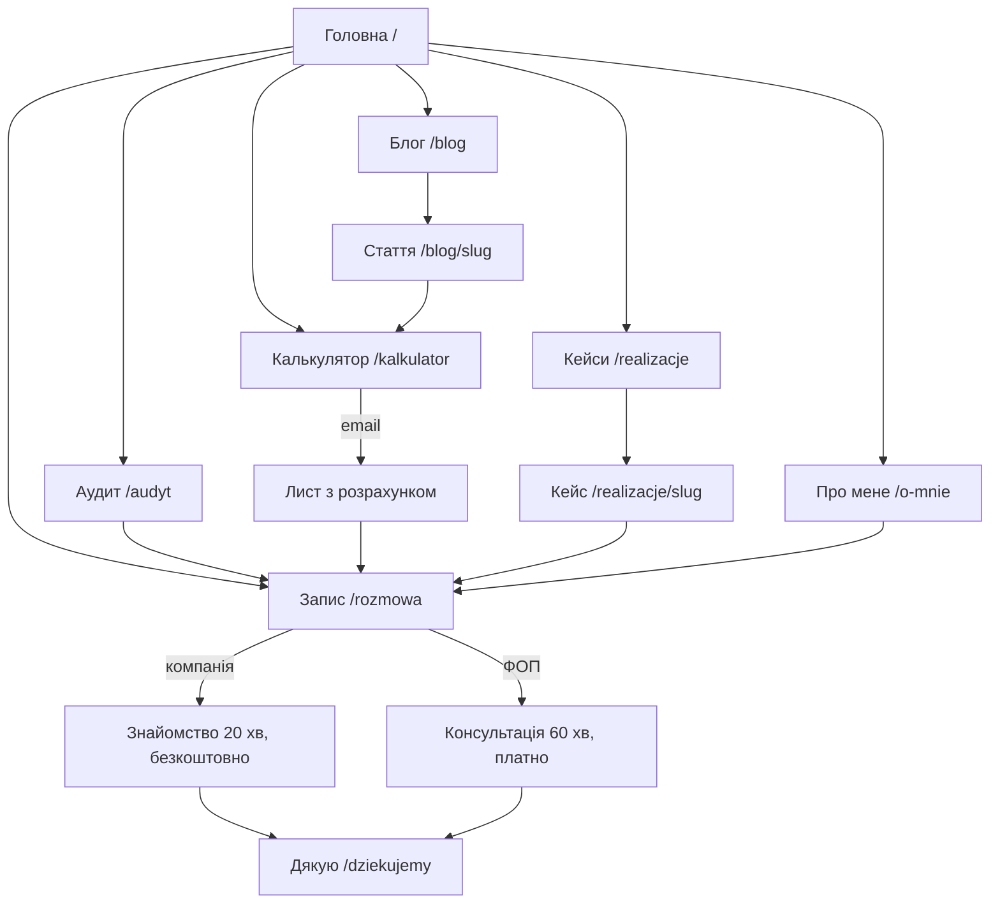

# Архітектура сайту: посил для відвідувача і продажі

Версія 2 · 23.10.2026. Робочий документ. Замінює три версії з `site-versions-brand.md`.
Notion (курс «Побудова особистого бренду», домашки) використано як базу знань.

Що змінилося у версії 2:
- IT-компанії прибрано з цільової аудиторії;
- фокус на HR і рекрутингу, малому й середньому бізнесі та ФОПах за кордоном;
- цін на сайті немає, крім консультації;
- відгуки на сайті стоять як позначені плейсхолдери;
- нові варіанти назви методу.

---

## 0. Зафіксовані рішення

| Що | Рішення |
|---|---|
| Для кого | 1) HR- і рекрутингові агенції; 2) малий і середній бізнес на 5–200 людей; 3) ФОПи та самозайняті за кордоном. Польща, ЄС, далі США. IT-компанії не цільові: вони впроваджують AI самі. |
| Що продаємо | Консультація → аудит процесів → AI-автоматизації та інтеграції (n8n, Make, AI-агенти, RAG, документи, розсилки) → навчання → супровід |
| Головна ідея | **Рутину — агентам, рішення — людям** |
| Переконання | В еру AI люди стають важливішими, ніж до цього |
| Тон | Прямо про інструменти, дбайливо з людьми |
| Червона лінія | Не беру проєкти, де мета — звільнення людей |
| Hero H1 | «Ваша команда тоне в ручній роботі. Я передаю її AI-агентам.» (погоджено) |
| ROI-калькулятор | Залишаємо |
| Ціни | На сайті лише ціна консультації. Аудит і впровадження — після розмови, з фіксованою ціною етапу до старту |
| Відгуки | Плейсхолдери з позначкою «приклад», замінюємо, коли будуть справжні |
| «Про мене» | Затверджений текст: `docs/content/about-me.md` |
| Ємність | ~10 год/тиждень, тому сайт має відсіювати |
| Мови | PL (основна), UA (важлива для ФОПів за кордоном), EN |

---

## 1. Ідея сайту

Головних відвідувачів троє:
- **Власник HR- або рекрутингової агенції:** кандидати в таблицях і пошті, ручні листи, договори, звіти для клієнтів.
- **Власник малого бізнесу:** заявки губляться, рахунки й звіти робляться руками.
- **ФОП за кордоном:** робить усе сам, від переписки з клієнтами до документів.

До AI вони ставляться з підозрою: або це хайп, або щось складне й дороге.

Сайт веде їх через чотири думки:
1. «Це про нас».
2. «Ось скільки це коштує».
3. «Ця людина вже робила це, і людям прижилося».
4. «Почати можна з однієї розмови».

**Чому HR і рекрутинг на першому місці.** Дві з трьох твоїх історій впровадження відбулися саме в HR-компаніях: переведення HR-агенції з Excel у CRM і ERP для HR-tech на 10 000+ користувачів. Це доказ, а не лише заявлена спеціалізація.

**Відмінність від агенцій на n8n і Make.** Вони продають флоу, а ти — автоматизації, якими люди справді користуються. Рішення про гроші й людей при цьому лишаються за людьми.

---

## 2. Message house

**Парасолька:** Рутину — агентам, рішення — людям.

| Опора | Обіцянка | Докази | Де на сайті |
|---|---|---|---|
| **Час** | Повертаю години рутини | Калькулятор; звіт для правління з 4–5 год до 5–10 хв; 30 stories з одного брифу | Калькулятор, кейси, «Понеділок після» |
| **Люди** | Автоматизації, якими користуються; рішення за людьми | 90% користуються ERP; після переходу в CRM жоден відділ не повернувся до Excel; людина затверджує рішення в кожному флоу | Позиція, метод, FAQ |
| **Досвід** | 5+ років CRM, ERP і AI, сам будую | Jira-агент: −87% витрат на AI, 0% галюцинацій на операціях запису, 10–15 людей у пілоті; 600–800 тис. рядків без критичних втрат; 2-ге місце серед 70+ команд на AI-хакатоні; власний SaaS | Історія, кейси, «Про мене» |

**Що кому говоримо:**

| Сегмент | Що болить | Що обіцяємо | Перший крок |
|---|---|---|---|
| HR і рекрутинг | Кандидати в Excel і пошті, ручні листи й записи на співбесіди, договори, звіти для клієнтів, синхронізація ATS і CRM | Рекрутери говорять з людьми, а не переносять дані | Безкоштовне знайомство 20 хв |
| МСБ 5–200 | Заявки губляться, рахунки й замовлення вручну, звіти з кількох систем | Заявки, рахунки й звіти рухаються самі | Безкоштовне знайомство 20 хв |
| ФОП за кордоном | Клієнти в месенджерах, рахунки й документи, запис клієнтів, усе вручну | Кілька годин на тиждень назад без найму помічника | Платна консультація 60 хв |

**Словник:**
- **Пишемо:** повернені години, рутина, людина ухвалює рішення, пілот, карта процесів.
- **Не пишемо:** скоротити штат, FTE, гарантую, революція, «70% не вміють», цифри без джерела.

**EU AI Act для HR.** AI-відбір кандидатів належить до високого ризику. HR-пропозицію ведемо через операційні автоматизації: комунікація з кандидатами, запис, документи, синхронізація ATS і CRM, звіти. Оцінку CV даємо лише як помічника, рішення ухвалює рекрутер, а вимоги перевіряємо до запуску.

---

## 3. Сюжет

Схема StoryBrand: клієнт — герой, ти — провідник.

| Елемент | На сайті |
|---|---|
| Герой | Власник агенції, малого бізнесу або ФОП |
| Зовнішня проблема | Рутина, Excel, загублені заявки, ручні документи й звіти |
| Внутрішня проблема | «Я гашу пожежі замість того, щоб розвивати бізнес» |
| Філософська проблема | AI мав би допомагати людям, а його продають як заміну людей |
| Провідник | Михайло: емпатія (бачив цей хаос зсередини) + авторитет (кейси з цифрами) |
| План | 4 кроки методу |
| Заклик | Прямий — розмова. Перехідний — калькулятор з листом. |
| Ставки (що буде, якщо нічого не робити) | Калькулятор: «ручна робота коштує вам N zł на рік» |
| Успіх | «Понеділок після»: той самий понеділок, 9:14, але спокійний |

**Рамка:** hero відкривається понеділком о 9:14 у хаосі, передостання секція закривається тим самим понеділком після впровадження.

---

## 4. Карта сайту

| Сторінка | URL (PL / UA / EN) | Навіщо | Головний CTA | Етап |
|---|---|---|---|---|
| Головна | `/` · `/ua/` · `/en/` | Уся історія і продаж | Записатися на розмову | MVP |
| Аудит процесів | `/audyt` · `/ua/audyt` · `/en/audit` | Пояснює головний продукт для компаній | Обговорити аудит | MVP |
| Калькулятор | `/kalkulator` · `/ua/kalkulyator` · `/en/calculator` | Лід-магніт, SEO, «переслати директору» | Отримати розрахунок на пошту | MVP |
| Кейси | `/realizacje` + 4 сторінки | Докази в деталях | Обговорити схожий процес | MVP |
| Про мене | `/o-mnie` · `/ua/pro-mene` · `/en/about` | Довіра до людини | Записатися на розмову | MVP |
| Блог | `/blog` + 3 статті на старті | SEO, постійність, довіра | Калькулятор / розмова | MVP (PL) |
| Запис | `/rozmowa` · `/ua/rozmova` · `/en/call` | 2 питання → безкоштовне знайомство або платна консультація | Забронювати | MVP |
| Дякую | `/dziekujemy` | Підтвердження й підрахунок конверсій | Що підготувати до розмови | MVP |
| Політики | `/polityka-prywatnosci`, `/cookies` | GDPR | — | MVP |
| HR і рекрутинг | `/agencje-hr-i-rekrutacyjne` · `/ua/hr-ta-rekrutynh` | SEO й реклама під головний сегмент | Записатися на розмову | Етап 2 (перша з галузевих) |
| Для ФОПів | `/ua/dlya-fop` | UA-сторінка під ФОПів за кордоном | Платна консультація | Етап 2 |
| Малий бізнес | `/male-firmy` | SEO під МСБ | Записатися на розмову | Етап 2 |
| Рентген процесу | `/rentgen` | Окремий AI-інструмент | Надіслати схему / розмова | Етап 2 |

**Меню:** Що автоматизую · Кейси · Як я працюю · Про мене · Блог · [Записатися].
**На мобільному:** липка кнопка «Записатися» після першого екрана.

---

## 5. Головна сторінка секція за секцією

| # | Секція | Що має подумати відвідувач | Текст (чернетка) | Інтерактив (з каталогу) | CTA |
|---|---|---|---|---|---|
| 1 | **Hero** | «Це про мою проблему, і за цим стоїть жива людина» | Eyebrow: «AI-автоматизації для HR- і рекрутингових агенцій та малого бізнесу». H1: «Ваша команда тоне в ручній роботі. Я передаю її AI-агентам.» Sub: «Знаходжу, де ви втрачаєте години, і автоматизую рутину на n8n, Make та AI-агентах. Рутину — агентам, рішення — людям.» Фото + 3 цифри. | Hero A «Стос сповіщень» | Записатися на розмову · Порахувати втрати |
| 2 | **Що я автоматизую** | «Він розуміє мій бізнес» | «Схоже на вас?» Перемикач: HR і рекрутинг / Малий і середній бізнес / ФОП і самозайняті. По 4 «було → стало». | Галузі C «Клікніть ручні кроки» | — |
| 3 | **Ціна хаосу** | «Це коштує нам N zł на рік» | «Скільки коштує ручна робота». Години на людину, zł на рік, що робитимете замість рутини. | ROI A (повзунки + графік) | Надіслати розрахунок на пошту |
| 4 | **Позиція** | «Він не продає AI-хайп» | «Чому я роблю це інакше». 3 принципи + «Не беру проєкти, де мета — звільнення людей». | Текст, що проявляється | — |
| 5 | **Історія** | «Він пройшов цей шлях» | Затверджений текст «Про мене», скорочений до 3 абзаців, + фото. | Історія A або C | Читати повністю → /o-mnie |
| 6 | **Кейси й відгуки** | «Це працює насправді» | 4 кейси з цифрами + 3 відгуки-плейсхолдери (розділ 6). | Кейси A (великі цифри) | Обговорити схожий процес |
| 7 | **Як я працюю** | «Ризик малий» | 4 кроки методу без дедлайнів; людина затверджує рішення в кожному флоу. | Процес C (ноди флоу) | — |
| 8 | **Рентген процесу** | «Для мого процесу це реально» | «Опишіть рутину, і агент покаже схему автоматизації». | Рентген C (3 питання) | Обговорити схему на розмові |
| 9 | **Як почати** | «Почати легко, ціни чесні» | 1) Знайомство 20 хв, безкоштовно, для компаній. 2) Консультація 60 хв, фіксована ціна, зараховується у впровадження. 3) Аудит і впровадження: фіксована ціна етапу після розмови, до старту робіт. 4) Супровід. | Ціни B (сходинки) без сум, крім консультації | Записатися |
| 10 | **Понеділок після** | «Хочу так» | «Ваш ранок починається з одного повідомлення». | Успіх C (Telegram) | — |
| 11 | **FAQ** | «Мої страхи зняті» | Першим «Чи замінить AI моїх людей?». Далі: дані й GDPR; що, як зламається; чи потрібен розробник; **скільки коштує**; скільки триває; чи має сенс для ФОПа. | FAQ A (акордеон) | — |
| 12 | **Запис** | «Легкий наступний крок» | «Почнімо з вашого понеділка». Що буде на розмові → 2 питання → календар. | Запис C (кваліфікація) | Забронювати |

**Українська версія для ФОПів:** H1 можна адаптувати під одну людину: «Тонете в ручній роботі? Передайте її AI-агентам.»

**Проміжні CTA:** після калькулятора — email; після кейсів і рентгену — запис; на телефоні — липка кнопка.

**Фон:** один активний фон тільки в hero, решта сторінки статична.

---

## 6. Відгуки: плейсхолдери

На сайті вони стоять з позначкою «Приклад відгуку». Справжні відгуки замінюють їх по одному. **Публікувати сайт із прикладами як зі справжніми відгуками не можна.**

> **[ПРИКЛАД, замінити]** «Михайло переклав нашу роботу з кандидатами з трьох таблиць в одну систему. Рекрутери перестали переносити дані вручну і щотижня мають на кілька годин більше на розмови з кандидатами.» — Ім'я, власниця рекрутингової агенції, Познань

> **[ПРИКЛАД, замінити]** «Заявки з сайту тепер одразу потрапляють у CRM, а менеджер отримує сповіщення. Ми перестали губити клієнтів у пошті.» — Ім'я, директор сервісної компанії на 25 людей

> **[ПРИКЛАД, замінити]** «Рахунки й нагадування клієнтам тепер ідуть самі. Я нарешті займаюся роботою, а не паперами.» — Ім'я, ФОП, Варшава

Шаблон запиту для справжніх відгуків: проєкт → результат → цифра → риса Михайла.

---

## 7. Ціни: що показуємо і чому

**Рекомендація.** Цін аудиту й впровадження на сайті немає: обсяг завжди індивідуальний, і цифра без контексту або відлякує, або обманює очікування. Показуємо три речі:
1. **Ціну консультації**, фіксовану. Вона фільтрує випадкових людей і оплачує твій час, коли розмова потрібна ФОПу чи маленькій компанії.
2. **Процес ціноутворення**: «фіксована ціна етапу після розмови, до старту робіт». Це прозоріше за прайс.
3. **Орієнтир у FAQ**: «Найменші проєкти впровадження починаються приблизно від 2 000 zł». Це м'який фільтр: людина з бюджетом 200 zł не забронює розмову даремно.

**Безкоштовне чи платне.**
- **Компанії** (агенції, МСБ від 5 людей) отримують безкоштовне знайомство на 20 хв. Це вхід у найбільші угоди.
- **ФОПи й компанії на 1–4 людей** отримують платну консультацію на 60 хв.
- Оплата при бронюванні через Cal.com і Stripe.

**Пропозиція ціни консультації (вирішити):** 399 zł / 99 €. Сума зараховується, якщо після консультації замовляють впровадження.

---

## 8. Інші сторінки

**Аудит процесів (`/audyt`):**
1. Для кого.
2. Що ви отримуєте:
   - карта процесів;
   - години по кожному процесу;
   - 3–5 пріоритетів за ROI;
   - план і фіксована ціна впровадження.
3. Як проходить: інтерв'ю з командою → аналіз систем і даних → презентація.
4. Вартість: після розмови, фіксована до старту.
5. Приклад сторінки карти процесів (розмитий).
6. FAQ.
7. Запис.

**Кейс (`/realizacje/[slug]`):**
1. Контекст.
2. Проблема в цифрах.
3. Схема флоу.
4. Де рішення ухвалює людина.
5. Результат у цифрах.
6. Відгук.
7. Стек.
8. CTA.

**Про мене (`/o-mnie`):** повний текст, 3 принципи, «чого я не роблю», досвід і сертифікати, фото, CTA.

**Калькулятор (`/kalkulator`):** інструмент, прозора формула, email з розрахунком і 3 процесами, з яких варто почати.

**Блог (`/blog`):**
- Рубрики:
  - кейси й розбори — 40%;
  - «як автоматизувати X» — 40%;
  - «AI і люди» — 20%.
- Перші статті (PL):
  1. «Ile kosztuje ręczna praca w agencji rekrutacyjnej» — веде на калькулятор.
  2. «Automatyzacja faktur i zamówień: od Excela do n8n».
  3. «Dlaczego wdrożenia AI się nie przyjmują — i jak to zmienić».

**Запис (`/rozmowa`):**
- Питання 1: хто ви (HR- або рекрутингова агенція / компанія 5–200 / ФОП чи самозайнятий / інше).
- Питання 2: що болить.
- Компанії йдуть на безкоштовне знайомство 20 хв.
- ФОП і 1–4 людини йдуть на платну консультацію 60 хв (або на чекліст на пошту).

---

## 9. Як сайт продає: воронка

| Етап | Де | Посил | Що приходить тобі в Telegram | Що міряємо |
|---|---|---|---|---|
| Трафік | LinkedIn, Google, рекомендації, блог, українські спільноти за кордоном (для ФОПів) | Ваша проблема має рішення | — | Відвідування за джерелами |
| Залучення | Hero, калькулятор, рентген | Подивіться на свої цифри | — | % тих, хто запустив калькулятор чи рентген |
| Лід | Email з калькулятора, бронювання, рентген | Розрахунок / схема / розмова | Сегмент, email, біль, цифри з калькулятора, відповіді рентгену, джерело | Лідів на тиждень, частка за сегментами |
| Розмова | Знайомство 20 хв або консультація 60 хв | Чесна оцінка, чи окупиться | Нагадування за годину; позначка, чи оплачено | % розмов → пропозиція |
| Пропозиція | Фіксована ціна етапу | Аудит або пілот | — | % пропозицій → оплата |
| Впровадження | Передоплата за етап | Пілот на одному процесі | — | % пілотів → наступний етап |
| Супровід | Підписка | Флоу не ламаються, нові сценарії | — | Утримання |
| Кейс і відгук | Після пілоту | Справжній відгук замість плейсхолдера | — | Кейсів на квартал |

**Листи після калькулятора (4 штуки, інтервал 2–3 дні):**
1. Ваш розрахунок і 3 процеси, з яких я б почав.
2. Історія ERP: чому людям прижилося.
3. Чому автоматизації не приживаються.
4. Запрошення на розмову.

**Що буде на розмові** (показуємо на сайті):
1. Ваш процес.
2. Де губляться години.
3. Чи окупиться автоматизація.
4. Наступний крок: аудит, пілот або «поки не варто».

**Правила рішень (раз на місяць):**
- Калькулятор запускає мало людей → піднімаємо вище або міняємо тизер.
- Багато розмов без потенціалу → посилюємо питання на `/rozmowa` або орієнтир ціни у FAQ.
- Розмови не переходять у пропозицію → переписуємо `/audyt` і скрипт розмови.

**Аналітика:**
- Umami або Plausible;
- Google Search Console;
- Clarity — лише за згодою;
- події:
  - `cta_hero`, `calc_used`, `calc_email`, `xray_done`;
  - `booking_free`, `booking_paid`;
  - `segment_hr`, `segment_smb`, `segment_solo`.

---

## 10. Назва методу

Відкинуто: People-First AI (не сподобалась), Lohaza Loop (небажана асоціація для російськомовних читачів), будь-які назви з прізвищем.

Human Gate — це загальноприйнятий термін в AI-автоматизаціях (так називають точку схвалення людиною). Він додає довіри, але своїм його не зробити, тому його краще залишити назвою принципу, а не методу.

| Варіант | UA / PL / EN | Сенс | Плюси | Ризики |
|---|---|---|---|---|
| **Tandem** | Тандем / Tandem / Tandem | Велосипед-тандем: попереду людина кермує, ззаду агент крутить педалі | Одне слово, однаково всіма трьома мовами, без поганих асоціацій, точно передає «рутину — агентам, рішення — людям», легко намалювати | Слово загальне (є застосунок Tandem для мовного обміну); перевірити торгову марку в класі консалтингу |
| **Метод 9:14** | Метод 9:14 / Metoda 9:14 / Method 9:14 | Понеділок, 9:14 — момент, з якого починається історія на сайті | Унікальна, пов'язана із сюжетом, легко зробити своєю | Без пояснення незрозуміла |
| **Вільні руки** | Вільні руки / Wolne ręce / Hands Free | Автоматизація звільняє руки команди | Людська, проста; польською є ідіома «wolna ręka» (свобода дій) | Англійською звучить як «без рук», про гарнітуру |
| **Calm Ops** | Calm Ops (усі мови) | Спокійні операції, як у «Понеділку після» | Сучасно, пов'язано з образом успіху | «Ops» звучить як жаргон для власника агенції чи ФОПа |
| **Routine Detox** | Детокс рутини / Detoks z rutyny / Routine Detox | Позбутися рутини | Запам'ятовується | Звучить як велнес, а не B2B |
| **Hybrid Team** | Гібридна команда / Zespół hybrydowy / Hybrid Team | Люди + агенти | Зрозуміло | Польською «hybrydowy» асоціюється з гібридною роботою (офіс + дім) |

**Рекомендація:** метод **Tandem**, принцип усередині **Human Gate**, слоган «Рутину — агентам, рішення — людям».
Друга опція: **Метод 9:14**, якщо хочеться назви, повністю прив'язаної до історії сайту.

**4 кроки:**
1. **Слухаю.** Інтерв'ю з командою, карта рутини.
2. **Автоматизую.** n8n, Make, AI-агенти, інтеграції; у кожному флоу є Human Gate.
3. **Навчаю.** Люди вміють користуватися і не бояться.
4. **Міряю.** Повернені години й частка людей, які користуються, потім наступний процес.

---

## 11. Відкрите

1. Назва методу: Tandem, 9:14 чи інша.
2. Ціна консультації (пропозиція 399 zł / 99 €) і чи давати безкоштовне знайомство компаніям.
3. Домен — адреса сайту (наприклад, lohaza.com, lohaza.pl, lohaza.eu). Не плутати з «доменом» як сферою бізнесу.
4. Хто такі «ФОПи за кордоном»: українські підприємці й самозайняті в Польщі та ЄС? Від цього залежить UA-сторінка.
5. Справжні відгуки замість плейсхолдерів.
6. Договір з роботодавцем щодо сторонньої діяльності перед публічним запуском.
